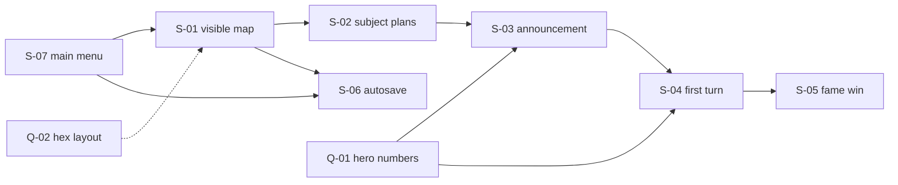

# GitHub issues from the M-1 roadmap

## Task system

Work sequencing lives in [context/foundation/roadmap.md](context/foundation/roadmap.md). The issues are on GitHub: `git@github.com:Katiczek/Grodowladcy.git`, milestone [M-1: First playable turn](https://github.com/Katiczek/Grodowladcy/milestone/1). There is no Linear, Jira, or GitHub Project. The roadmap file stays the source of truth for order and status; these issues are the backlog.

Nine issues are open: S-07 through S-06, plus Q-01 and Q-02. Parked non-goals stay in the roadmap only.

## Fields on every issue

- **Title:** `S-07` / `Q-01` prefix plus a short English line.
- **Milestone:** `M-1: First playable turn`
- **Labels:** type, stream, and status, using only the names below.
- **Body sections,** in English: Outcome, What to achieve, PRD references, Prerequisites, Parallel with, Questions, Risks, Done when, Out of scope, Tracking (`Change ID`, roadmap status, source paths).

Player-facing buttons on the menu are **New game** and **Continue**. Continue is the on-screen name for the FR-002 load.

## Labels

These are the roadmap labels on the repo now:

- `roadmap:slice` — vertical slice from the M-1 roadmap
- `roadmap:question` — a decision the roadmap still needs from a person
- `stream:turn-loop` — stream A, the turn loop from the map to the fame win
- `stream:session-save` — stream B, leave a session and load it again
- `status:ready-to-work` — can be planned now
- `status:blocked` — waiting on a prerequisite slice, an answer, or both

`status:proposed` and `status:non-blocking` are not on the repo. Slices that are still waiting use `status:blocked`. The two questions carry `roadmap:question` only.

## Dependency shape

## Issues

**S-07: Main menu** ([#15](https://github.com/Katiczek/Grodowladcy/issues/15), `show-main-menu`, roadmap status ready)

- Labels: `roadmap:slice`, `stream:turn-loop`, `stream:session-save`, `status:ready-to-work`
- Both stream labels: New game enters the turn loop, Continue is the session-save entry.
- Outcome: the player sees a main menu with New game and Continue.
- Achieve: those two buttons only. New game leaves the menu toward S-01. Continue does not open a session when there is no autosave; loading stays in S-06.
- PRD: US-01, FR-001, FR-002.
- Prerequisites: none. Parallel: none. Questions: none.
- Risk: building the map or the save here would swallow S-01 and S-06.
- Done when: the first screen shows both buttons, New game leaves the menu, and Continue with no save does not open a session.

**Q-01: Three heroes walks into a bar, but left stat blocks at home** ([#7](https://github.com/Katiczek/Grodowladcy/issues/7))

- Labels: `roadmap:question`
- The only Open Roadmap Question. Owner: you. It blocks S-03 and S-04.
- Ask for three heroes in each turn's pool: public stats, hidden coin threshold, and strength.
- Already fixed elsewhere: pool size 3, accept when offered coins `>=` hidden threshold, enemy strength monster 5 / village 3 / own-field defense 2. The PRD Open Questions section is closed (fame 20, start 10/0/3, farm and house costs).

**Q-02: The map is shy about every hex past the starter pack** ([#8](https://github.com/Katiczek/Grodowladcy/issues/8))

- Labels: `roadmap:question`
- From S-01 Unknowns. Owner: you. Does not block S-01.
- US-01 already requires a capital, empty fields, one neutral village, and one monster.

**S-01: Crown the kingdom, then admire a map with no army** ([#9](https://github.com/Katiczek/Grodowladcy/issues/9), `start-on-visible-map`, roadmap status proposed)

- Labels: `roadmap:slice`, `stream:turn-loop`, `status:ready-to-work`
- Outcome: after New game, a local name and the hex map with the capital, coins, fame, and the subject pool.
- Achieve: local profile, predefined map, always-visible resources. Start values 10 coins / 0 fame / 3 subjects (FR-001, FR-008, US-01). The menu itself is S-07. Today the scene is an empty board (`Assets/Scenes/SampleScene.unity`).
- PRD: US-01, FR-001, FR-008.
- Prerequisites: S-07. Parallel: none. Question: Q-02, and it does not block.
- Risk: this is the first visible board. Resolution rules already exist and must not be rebuilt ahead of the screen.
- Done when: New game leads to a named game that shows the minimum map and the three starting resources.

**S-02: Subjects file a plan; the shovel is not on this shift** ([#11](https://github.com/Katiczek/Grodowladcy/issues/11), `plan-subject-action`, roadmap status proposed)

- Labels: `roadmap:slice`, `stream:turn-loop`, `status:blocked`
- Outcome: pick a neighboring hex, plan claim / farm / house, end the subject phase.
- Achieve: adjacent-to-kingdom selection only (FR-003, FR-004, FR-005). Farm costs 3 and yields +2 coins/turn; house costs 4 and adds +1 subject. The choice is visible at once; the tile changes only when the turn resolves.
- Prerequisites: S-01. Parallel: S-06. Questions: none.
- Risk: do not apply farm, house, or claim to the map during this phase.
- Done when: the player can plan one legal action and press End phase into the hire phase.

**S-03: Pin a coin bounty on the tavern door and wait** ([#12](https://github.com/Katiczek/Grodowladcy/issues/12), `post-hero-announcement`, roadmap status blocked)

- Labels: `roadmap:slice`, `stream:turn-loop`, `status:blocked`
- Outcome: browse three heroes and post an announcement with a field and a coin reward.
- Achieve: public-stat list, field pick, coin reward, task type taken from the tile (monster to kill, village to capture, own field to defend). The player does not pick the task type (FR-006, FR-007, FR-005, US-01).
- Prerequisites: S-02. Parallel: none. Question: Q-01, and it blocks this issue.
- Risk: a hero list without those numbers would be a guess. After the numbers exist, the slice stays narrow because task type already follows the tile.
- Out of scope: accept/ignore and mission success (those are S-04).
- Done when: the player can post one announcement whose summary shows the derived task and the offered coins.

**S-04: Close the turn with a contract or a very small funeral** ([#13](https://github.com/Katiczek/Grodowladcy/issues/13), `resolve-first-turn`, roadmap status blocked)

- Labels: `roadmap:slice`, `stream:turn-loop`, `status:blocked`
- Outcome: end the turn and see whether the hero accepted, whether the mission succeeded, and what the subject plans did.
- Achieve: hidden assignment after End phase (`offered >= threshold` via existing `HeroAssignment`), then the player sees accepted or ignored. Phase 3 stays on the map. Accepted jobs use existing `MissionResolver`: success gives monster +3 fame, village +5 coins once, defense +1 fame; failure tells the player the hero died on the job (FR-005, FR-014, US-01). Exact player-facing sentences stay in the PRD.
- Prerequisites: S-03. Parallel: none. Question: Q-01, still blocking because resolution needs hero strength.
- Risk: accept and mission outcome stay one slice; the PRD puts them in one phase. This is the north star.
- Done when: one full turn shows accept-or-ignore, mission outcome, and the subject-plan results.

**S-05: Fame is a long con: twenty points or we go again** ([#14](https://github.com/Katiczek/Grodowladcy/issues/14), `repeat-turns-until-fame-win`, roadmap status proposed)

- Labels: `roadmap:slice`, `stream:turn-loop`, `status:blocked`
- Outcome: repeat turns and win at the fame threshold.
- Achieve: after resolution, fame `>=` 20 wins; otherwise return to phase 1 with a fresh pool of 3 heroes (FR-005, US-01). Use existing `WinCondition` and `GameConstants.FameToWin`.
- Prerequisites: S-04. Parallel: none. Questions: none.
- Risk: the win screen does not prove the game until one turn can change fame, so this stays behind S-04.
- Done when: a session can loop and end in a win at 20 fame.

**S-06: Quitting is legal; amnesia is not** ([#10](https://github.com/Katiczek/Grodowladcy/issues/10), `load-phase-one-autosave`, roadmap status proposed)

- Labels: `roadmap:slice`, `stream:session-save`, `status:blocked`
- Outcome: leave a session and return with Continue.
- Achieve: autosave to a local file at the start of phase 1. Continue, already on the S-07 menu, loads that file (FR-002, US-01). Offline, no cloud. Guardrail: map, coins, and fame survive leaving the app.
- Prerequisites: S-07 and S-01. Parallel: S-02. Questions: none.
- Risk: save only needs a started session, so it may run beside the subject phase and must not jump ahead of the first playable turn.
- Done when: quitting after phase 1 begins and choosing Continue restores that session.
