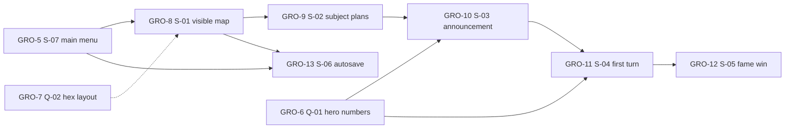

# Linear issues from the M-1 roadmap

## Task system

Work sequencing still lives in [context/foundation/roadmap.md](context/foundation/roadmap.md). The GitHub backlog is [context/foundation/tasks-github.md](context/foundation/tasks-github.md), on `git@github.com:Katiczek/Grodowladcy.git`, milestone [M-1: First playable turn](https://github.com/Katiczek/Grodowladcy/milestone/1). This file is the Linear copy of those nine issues, created in the workspace [Grodowładcy](https://linear.app/grodowladcy) on 2026-10-11.

The roadmap file stays the source of truth for order and status. GitHub issues and these Linear issues are the same backlog in two trackers. Parked non-goals stay in the roadmap only. [tasks-github.md](context/foundation/tasks-github.md) was not edited in that session, so its line "There is no Linear, Jira, or GitHub Project" is stale.

Signed-in Linear user for the copy: Magda (`magdazj@op.pl`), admin, team **Grodowładcy** (`GRO`, `369f0809-8588-4079-ad42-6a60769d0d88`).

## Where the GitHub milestone went

Linear milestones belong to a project, so the GitHub milestone became both:

- **Project** [M-1: First playable turn](https://linear.app/grodowladcy/project/m-1-first-playable-turn-06aafbe84ef2) (`P-GRO-1`, `2cacf56c-5a13-43eb-88a7-1d2bc295fad1`). Team Grodowładcy, lead Magda, status Planned. Summary: main menu through the fame win. External link: the GitHub milestone. No icon; a `Castle` icon was rejected as invalid.
- **Project milestone** of the same name (`a85db967-d6b2-49f7-b9de-adaa8e6ba44c`). Every mirrored issue is on this project and this milestone.

## Fields on every issue

Same rules as the GitHub list, mapped onto Linear:

- **Title:** `S-07` / `Q-01` prefix plus the same English line as GitHub.
- **Project and milestone:** `M-1: First playable turn`.
- **Labels:** the GitHub names below. Questions carry `roadmap:question` only.
- **Body sections,** in English: Outcome, What to achieve, PRD references, Prerequisites, Parallel with, Questions, Risks, Done when, Out of scope, Tracking (`Change ID`, roadmap status, GitHub URL, source path `context/foundation/tasks-github.md`).
- **Attachment:** the matching GitHub issue.
- **Workflow state:** `status:ready-to-work` is Todo. `status:blocked` is Backlog. The two questions are Todo because they need an answer, and they have no readiness label.
- **Assignee:** Q-01 and Q-02 are assigned to Magda ("Owner: you" in the GitHub list). Slices are unassigned.

Player-facing buttons on the menu stay **New game** and **Continue**. Continue is the on-screen name for the FR-002 load. That note is in the S-07 body.

## Labels

GitHub label names were kept. Linear grouping differs because of two workspace limits:

- A label group named `status` is reserved, so the group is `readiness` (`85a63889-e177-4a08-87c2-2beec417d29b`). Children keep the GitHub names `status:ready-to-work` and `status:blocked`. The group is single-select.
- Multi-select label groups are not enabled, so the two stream labels are ungrouped. S-07 can carry both. A `stream` group was not created.

| Label | Group | Color | Id | Meaning |
| --- | --- | --- | --- | --- |
| `roadmap:slice` | `roadmap` (single-select, `f911febd-38cd-437c-80eb-2304c7c69bf0`) | `#4CB782` | `b74740d4-7600-4c51-afb0-71d64a3dd293` | Vertical slice from the M-1 roadmap |
| `roadmap:question` | `roadmap` | `#F2994A` | `40459fd8-5c09-4e4f-a69f-24448f8d568c` | A decision the roadmap still needs from a person |
| `stream:turn-loop` | none | `#5E6AD2` | `9760019b-26a6-48ba-80b8-119a447e6e5c` | Stream A, the turn loop from the map to the fame win |
| `stream:session-save` | none | `#26B5CE` | `c3fdc415-54de-4d25-8c36-d7313fafe987` | Stream B, leave a session and load it again |
| `status:ready-to-work` | `readiness` | `#4CB782` | `f1c38a08-574f-4614-99ba-69694ab4d1f2` | Can be planned now |
| `status:blocked` | `readiness` | `#EB5757` | `f47bc3e2-c5c6-4118-a750-5865ce9e2a77` | Waiting on a prerequisite slice, an answer, or both |

`status:proposed` and `status:non-blocking` were not created. Default workspace labels `Feature`, `Improvement`, and `Bug` were left as they were.

Team workflow statuses, unchanged: Backlog, Todo, In Progress, In Review, Done, Canceled, Duplicate.

## Dependency shape

Solid arrows are Linear **blocks** relations. The dotted arrow is **related**, not blocking. S-02 and S-06 are also related, because they can run in parallel.

Checked after create: S-01 is blocked by S-07 and related to Q-02. S-06 is blocked by S-07 and S-01, and related to S-02. S-03 is blocked by S-02 and Q-01. S-04 is blocked by S-03 and Q-01. S-05 is blocked by S-04.

## Issues

**S-07: Main menu** ([GRO-5](https://linear.app/grodowladcy/issue/GRO-5/s-07-main-menu), GitHub [#15](https://github.com/Katiczek/Grodowladcy/issues/15), `show-main-menu`, roadmap status ready)

- State: Todo. Labels: `roadmap:slice`, `stream:turn-loop`, `stream:session-save`, `status:ready-to-work`.
- Both stream labels: New game enters the turn loop, Continue is the session-save entry.
- Outcome: the player sees a main menu with New game and Continue.
- Achieve: those two buttons only. New game leaves the menu toward S-01. Continue does not open a session when there is no autosave; loading stays in S-06.
- PRD: US-01, FR-001, FR-002.
- Prerequisites: none. Parallel: none. Questions: none.
- Risk: building the map or the save here would swallow S-01 and S-06.
- Done when: the first screen shows both buttons, New game leaves the menu, and Continue with no save does not open a session.

**Q-01: Three heroes walks into a bar, but left stat blocks at home** ([GRO-6](https://linear.app/grodowladcy/issue/GRO-6/q-01-three-heroes-walks-into-a-bar-but-left-stat-blocks-at-home), GitHub [#7](https://github.com/Katiczek/Grodowladcy/issues/7))

- State: Todo. Assignee: Magda. Labels: `roadmap:question` only.
- The only open roadmap question. It blocks S-03 and S-04.
- Ask for three heroes in each turn's pool: public stats, hidden coin threshold, and strength.
- Already fixed elsewhere: pool size 3, accept when offered coins `>=` hidden threshold, enemy strength monster 5 / village 3 / own-field defense 2. The PRD Open Questions section is closed (fame 20, start 10/0/3, farm and house costs).
- Change ID: none.

**Q-02: The map is shy about every hex past the starter pack** ([GRO-7](https://linear.app/grodowladcy/issue/GRO-7/q-02-the-map-is-shy-about-every-hex-past-the-starter-pack), GitHub [#8](https://github.com/Katiczek/Grodowladcy/issues/8))

- State: Done (answered 2026-10-21). Assignee: Magda. Labels: `roadmap:question` only.
- From S-01 unknowns. Related to S-01. Does not block S-01.
- Answer: 19 hexes. Capital at axial (0, 0). Ring 1: empty (1, 0), (1, −1), (−1, 0), (−1, 1); monster (0, −1); neutral village (0, 1). Ring 2 is twelve empty hexes. Recorded in `context/foundation/prd.md`.
- Change ID: none.

**S-01: Crown the kingdom, then admire a map with no army** ([GRO-8](https://linear.app/grodowladcy/issue/GRO-8/s-01-crown-the-kingdom-then-admire-a-map-with-no-army), GitHub [#9](https://github.com/Katiczek/Grodowladcy/issues/9), `start-on-visible-map`, roadmap status proposed)

- State: Todo. Labels: `roadmap:slice`, `stream:turn-loop`, `status:ready-to-work`.
- Blocked by S-07. Related to Q-02, answered 2026-10-21; it does not block.
- Outcome: after New game, a local name and the hex map with the capital, coins, fame, and the subject pool.
- Achieve: local profile, predefined map, always-visible resources. Start values 10 coins / 0 fame / 3 subjects (FR-001, FR-008, US-01). The menu itself is S-07. Today the scene is an empty board (`Assets/Scenes/SampleScene.unity`).
- Done when: New game leads to a named game that shows the minimum map and the three starting resources.

**S-02: Subjects file a plan; the shovel is not on this shift** ([GRO-9](https://linear.app/grodowladcy/issue/GRO-9/s-02-subjects-file-a-plan-the-shovel-is-not-on-this-shift), GitHub [#11](https://github.com/Katiczek/Grodowladcy/issues/11), `plan-subject-action`, roadmap status proposed)

- State: Backlog. Labels: `roadmap:slice`, `stream:turn-loop`, `status:blocked`.
- Blocked by S-01. Related to S-06 (parallel).
- Outcome: pick a neighboring hex, plan claim / farm / house, end the subject phase.
- Achieve: adjacent-to-kingdom selection only (FR-003, FR-004, FR-005). Farm costs 3 and yields +2 coins/turn; house costs 4 and adds +1 subject. The choice is visible at once; the tile changes only when the turn resolves.
- Risk: do not apply farm, house, or claim to the map during this phase.
- Done when: the player can plan one legal action and press End phase into the hire phase.

**S-03: Pin a coin bounty on the tavern door and wait** ([GRO-10](https://linear.app/grodowladcy/issue/GRO-10/s-03-pin-a-coin-bounty-on-the-tavern-door-and-wait), GitHub [#12](https://github.com/Katiczek/Grodowladcy/issues/12), `post-hero-announcement`, roadmap status blocked)

- State: Backlog. Labels: `roadmap:slice`, `stream:turn-loop`, `status:blocked`.
- Blocked by S-02 and Q-01.
- Outcome: browse three heroes and post an announcement with a field and a coin reward.
- Achieve: public-stat list, field pick, coin reward, task type taken from the tile (monster to kill, village to capture, own field to defend). The player does not pick the task type (FR-006, FR-007, FR-005, US-01).
- Out of scope: accept/ignore and mission success (those are S-04).
- Done when: the player can post one announcement whose summary shows the derived task and the offered coins.

**S-04: Close the turn with a contract or a very small funeral** ([GRO-11](https://linear.app/grodowladcy/issue/GRO-11/s-04-close-the-turn-with-a-contract-or-a-very-small-funeral), GitHub [#13](https://github.com/Katiczek/Grodowladcy/issues/13), `resolve-first-turn`, roadmap status blocked)

- State: Backlog. Labels: `roadmap:slice`, `stream:turn-loop`, `status:blocked`.
- Blocked by S-03 and Q-01. Q-01 still blocks because resolution needs hero strength.
- Outcome: end the turn and see whether the hero accepted, whether the mission succeeded, and what the subject plans did.
- Achieve: hidden assignment after End phase (`offered >= threshold` via existing `HeroAssignment`), then the player sees accepted or ignored. Phase 3 stays on the map. Accepted jobs use existing `MissionResolver`: success gives monster +3 fame, village +5 coins once, defense +1 fame; failure tells the player the hero died on the job (FR-005, FR-014, US-01). Exact player-facing sentences stay in the PRD.
- Done when: one full turn shows accept-or-ignore, mission outcome, and the subject-plan results.

**S-05: Fame is a long con: twenty points or we go again** ([GRO-12](https://linear.app/grodowladcy/issue/GRO-12/s-05-fame-is-a-long-con-twenty-points-or-we-go-again), GitHub [#14](https://github.com/Katiczek/Grodowladcy/issues/14), `repeat-turns-until-fame-win`, roadmap status proposed)

- State: Backlog. Labels: `roadmap:slice`, `stream:turn-loop`, `status:blocked`.
- Blocked by S-04.
- Outcome: repeat turns and win at the fame threshold.
- Achieve: after resolution, fame `>=` 20 wins; otherwise return to phase 1 with a fresh pool of 3 heroes (FR-005, US-01). Use existing `WinCondition` and `GameConstants.FameToWin`.
- Done when: a session can loop and end in a win at 20 fame.

**S-06: Quitting is legal; amnesia is not** ([GRO-13](https://linear.app/grodowladcy/issue/GRO-13/s-06-quitting-is-legal-amnesia-is-not), GitHub [#10](https://github.com/Katiczek/Grodowladcy/issues/10), `load-phase-one-autosave`, roadmap status proposed)

- State: Backlog. Labels: `roadmap:slice`, `stream:session-save`, `status:blocked`.
- Blocked by S-07 and S-01. Related to S-02 (parallel).
- Outcome: leave a session and return with Continue.
- Achieve: autosave to a local file at the start of phase 1. Continue, already on the S-07 menu, loads that file (FR-002, US-01). Offline, no cloud. Guardrail: map, coins, and fame survive leaving the app.
- Done when: quitting after phase 1 begins and choosing Continue restores that session.

## Left unchanged

Linear onboarding issues were already in the team and were not part of the mirror: [GRO-1](https://linear.app/grodowladcy/issue/GRO-1/get-familiar-with-linear) Get familiar with Linear, [GRO-2](https://linear.app/grodowladcy/issue/GRO-2/connect-your-tools) Connect your tools, [GRO-3](https://linear.app/grodowladcy/issue/GRO-3/import-your-data) Import your data, [GRO-4](https://linear.app/grodowladcy/issue/GRO-4/set-up-your-teams) Set up your teams. All four were Todo with no labels.
